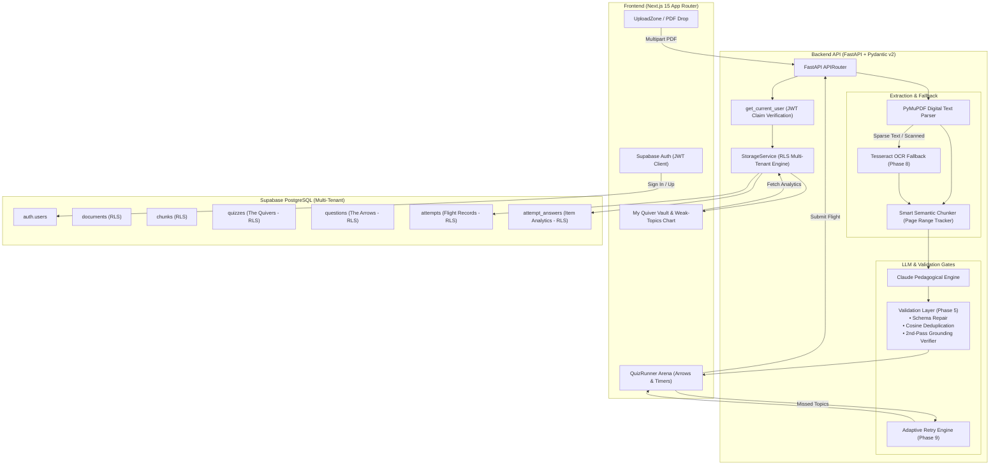

<div align="center">


### *AI-Powered Document Intelligence Turning PDFs into Interactive, Source-Grounded Quizzes*

[](https://nextjs.org/)
[](https://fastapi.tiangolo.com/)
[](https://python.org/)
[](https://www.typescriptlang.org/)
[](https://supabase.com/)
[](https://tailwindcss.com/)
[](#license)

<br />

[Features](#-key-features) • [Architecture](#-system-architecture) • [Quickstart](#-quickstart--local-setup) • [Database & Security](#-database-architecture--security-viva) • [Viva Guide](#-viva-defense-talking-points) • [Test Suites](#-automated-verification-suites)

</div>

---

## 🎯 The Quivers Concept & Design System

Traditional study apps rely on loose, hallucinated questions disconnected from the syllabus. **Quivers** re-imagines document-based learning through the disciplined metaphor of **archery**:

> 🏹 **The Arrow**: Every question is an individual, source-grounded challenge forged strictly from the document.  
> 🎯 **The Bullseye**: Accurate answers trigger target feedback accompanied by verified PDF page citations and verbatim excerpts.  
> 🗃️ **The Quiver**: The vault holding your complete collection of questions, flight attempt histories, and topic mastery analytics.

Quivers blends a **monochrome foundation** (obsidian black and crisp white) with a warm **amber-gold accent** inspired by leather archery gear and the 10-ring bullseye, featuring a distraction-free dark/light theme engine.

---

## ✨ Key Features Across Phases

### 📄 1. Hybrid PDF Extraction & OCR Fallback (Phases 2 & 8)
- **High-Speed Native Extraction**: Uses **PyMuPDF (`fitz`)** for sub-millisecond digital text parsing and bounding-box coordination.
- **Phase 8 Tesseract OCR Fallback**: Scanned or image-only pages lacking selectable font streams (`< 20` characters) automatically route to an embedded **Tesseract OCR engine** (`eng.traineddata`).
- **Scan Artifact Cleaning**: Cleans form-feeds, reconnects words split by hyphens across line breaks, and merges OCR results into the unified pipeline with zero user friction.

### 🧠 2. Smart Semantic Chunking (Phase 3)
- Bounded text splitting by structured section headings (`# Heading`, `1.2 Section`, academic keywords).
- Falls back gracefully to page groups while enforcing a maximum word limit (`750` words).
- **Page Citation Preservation**: Every chunk retains its starting and ending page numbers (`Page 1`, `Pages 3–5`) so questions can cite exact sources.

### ⚡ 3. Pedagogical Question Formulation (Phase 4)
- Formulates questions using **Anthropic Claude API** with strict JSON schemas.
- Configurable question types:
  - **Multiple Choice (MCQ)**: 4 distinct, plausible options with single target key.
  - **True / False**: Binary conceptual verification statements.
  - **Fill-in-the-Blank**: Precision contextual terminology retrieval.
- **Bloom’s Cognitive Taxonomy**: Levels tagged per arrow (*Recall*, *Understanding*, *Application*).
- Difficulty presets (*Easy*, *Medium*, *Hard*, *Mixed*).

### 🛡️ 4. Validation Layer — The Core Differentiator (Phase 5)
Quivers does not blindly return raw LLM outputs. Every candidate arrow passes through an automated multi-stage validation gate:
1. **Schema Self-Repair**: Validates JSON schema adherence with 1-shot repair retries.
2. **Continuous Embedding Deduplication**: Vectorizes question stems via TF-IDF cosine similarity to quarantine near-duplicate questions.
3. **2nd-Pass LLM Grounding Verifier**: An independent verification pass evaluates: *"Is the correct answer supported by this source passage?"* Questions with hallucinated answers or unsupported claims are rejected.
4. **Validation Report Audit**: Displays full transparency on generated, accepted, and quarantined questions alongside the quiz.

### 🏹 5. Interactive Quiz Arena (Phase 6)
- Step-by-step single-question view with animated **Arrow Progress Bar**.
- Configurable countdown timers (*30s*, *60s*, *Total Flight*).
- Immediate target bullseye feedback with verbatim document citations and page links.
- Results flight evaluation: score percentage, mastery ranks (*Bullseye Master*, *Sharpshooter*, *Marksman*, *Archer in Training*), and detailed question review.

### 🏛️ 6. "My Quiver" Vault & RLS Isolation (Phases 1B & 7)
- **Supabase Email Authentication**: Sign up, log in, session persistence, and protected routes.
- **Strict Row Level Security (RLS)**: Enforces `auth.uid() = user_id` across all relational tables (`documents`, `chunks`, `quizzes`, `questions`, `attempts`, `attempt_answers`).
- **FastAPI JWT Guard**: Derives `user_id` exclusively from cryptographic bearer tokens; user ID is **never** accepted from request bodies.
- **Weak-Topics Analytics Chart**: Aggregates learner attempt histories, calculates per-topic accuracy percentages, and generates actionable study recommendations citing specific PDF pages.

### 🔄 7. Adaptive Retry Flights (Phase 9)
- Analyzes incorrect answers from a completed quiz and identifies specific knowledge gaps.
- Generates a targeted **Adaptive Remediation Quiver** focusing strictly on missed topics.
- **Non-Repetition Guarantee**: Filters out previously seen question stems to ensure fresh, novel challenge angles.
- Seamlessly launches the remediation session in-place to close learning gaps.

---

## 🏛️ System Architecture



---

## 📂 Project Directory Structure

```
Quivers/
├── backend/
│   ├── app/
│   │   ├── api/
│   │   │   ├── auth.py                  # JWT validation & user session endpoints
│   │   │   ├── documents.py             # PDF upload & extraction routes
│   │   │   ├── health.py                # Pre-flight diagnostic matrix
│   │   │   └── quizzes.py               # Question generation & adaptive retry endpoints
│   │   ├── core/
│   │   │   └── auth.py                  # Supabase JWT authorization dependency
│   │   ├── models/
│   │   │   ├── document.py              # Page extraction & chunk models
│   │   │   ├── question.py              # Arrow schemas, Bloom levels, adaptive requests
│   │   │   ├── storage.py               # Document, quiz, attempt, and analytics schemas
│   │   │   └── validation.py            # Grounding check & validation report models
│   │   ├── services/
│   │   │   ├── chunker.py               # Semantic heading chunker
│   │   │   ├── ocr_service.py           # Tesseract embedded OCR service
│   │   │   ├── pdf_extractor.py         # PyMuPDF extraction engine
│   │   │   ├── question_generator.py    # Strict LLM formulation & adaptive engine
│   │   │   ├── storage_service.py       # Persistence & weak-topics calculator
│   │   │   └── validator.py             # Deduplication & grounding verifier
│   │   ├── config.py                    # Environment settings via Pydantic
│   │   └── main.py                      # FastAPI lifespan, routing, CORS
│   ├── tessdata/
│   │   └── eng.traineddata              # Tesseract English language training data
│   ├── requirements.txt                 # Backend Python dependencies
│   └── test_*.py                        # Comprehensive phase test suites
│
├── frontend/
│   ├── src/
│   │   ├── app/
│   │   │   ├── login/page.tsx           # Email login portal
│   │   │   ├── signup/page.tsx          # Account creation portal
│   │   │   ├── quivers/page.tsx         # "My Quiver" saved quizzes & weak topics
│   │   │   ├── layout.tsx               # Root layout & anti-flicker theme script
│   │   │   └── page.tsx                 # Landing page & live demo arena
│   │   ├── components/
│   │   │   ├── ArrowProgressBar.tsx     # Arrow-flight visual motif
│   │   │   ├── AuthProvider.tsx         # Supabase Auth context provider
│   │   │   ├── BackendHealthCard.tsx    # Live service diagnostic status
│   │   │   ├── BullseyeFeedback.tsx     # Target feedback with citation badge
│   │   │   ├── ExtractionResultViewer.tsx# Chunk inspector & debug view
│   │   │   ├── Navbar.tsx               # Brand header with theme toggle & user pill
│   │   │   ├── QuestionGeneratorPanel.tsx# Question forge controls & audit report
│   │   │   ├── QuizRunner.tsx           # Full-screen interactive quiz arena
│   │   │   └── UploadZone.tsx           # Drag-and-drop PDF dropzone
│   │   └── lib/
│   │       ├── api.ts                   # Type-safe API client & interfaces
│   │       └── supabase.ts              # Client-safe Supabase browser client
│   └── package.json                     # Frontend Next.js dependencies
│
├── supabase/
│   └── migrations/
│       ├── 00_full_schema.sql           # Complete schema baseline
│       ├── 01_create_tables.sql         # Relational tables with foreign key cascades
│       ├── 02_create_indexes.sql        # High-performance query indexes
│       └── 03_enable_rls_and_policies.sql# Multi-tenant Row Level Security policies
│
├── DATABASE.md                          # Viva defense database & security architecture guide
└── README.md                            # You are here
```

---

## 🚀 Quickstart & Local Setup

### 1. Prerequisites
- **Python**: Version 3.10+ (tested on Python 3.13)
- **Node.js**: Version 18+ (tested on Node.js 20+)
- **Supabase Account**: (Free tier project) for PostgreSQL & Auth

---

### 2. Backend Setup

```bash
# Navigate to backend
cd backend

# Create virtual environment (optional but recommended)
python -m venv .venv
# Windows
.venv\Scripts\activate
# Linux/macOS
source .venv/bin/activate

# Install dependencies
pip install -r requirements.txt

# Configure environment variables
cp .env.example .env
```

Edit `backend/.env`:
```env
ANTHROPIC_API_KEY=your_claude_api_key
SUPABASE_URL=https://your-project.supabase.co
SUPABASE_SERVICE_ROLE_KEY=your_supabase_service_role_key
```

Run the backend server:
```bash
python -m uvicorn app.main:app --reload --port 8000
```
- Interactive Swagger UI: [http://localhost:8000/docs](http://localhost:8000/docs)
- Health Check: [http://localhost:8000/health](http://localhost:8000/health)

---

### 3. Frontend Setup

```bash
# Navigate to frontend
cd frontend

# Install packages
npm install

# Configure environment variables
cp .env.example .env.local
```

Edit `frontend/.env.local`:
```env
NEXT_PUBLIC_SUPABASE_URL=https://your-project.supabase.co
NEXT_PUBLIC_SUPABASE_ANON_KEY=your_supabase_anon_key
NEXT_PUBLIC_BACKEND_URL=http://localhost:8000
```

Start development server:
```bash
npm run dev
```
Open [http://localhost:3000](http://localhost:3000) in your browser.

---

### 4. Database Migrations (Supabase)

Execute the migrations in the **Supabase SQL Editor** in numbered order:
1. `supabase/migrations/01_create_tables.sql`
2. `supabase/migrations/02_create_indexes.sql`
3. `supabase/migrations/03_enable_rls_and_policies.sql`

*(Or execute `supabase/migrations/00_full_schema.sql` in a single run).*

---

## 🧪 Automated Verification Suites

Quivers includes standalone test suites for every phase:

| Test Suite | Phase Verified | Command |
| :--- | :--- | :--- |
| [`test_adaptive_retry.py`](file:///backend/test_adaptive_retry.py) | **Phase 9: Adaptive Retry Engine** | `python backend/test_adaptive_retry.py` |
| [`test_ocr_scanned_pdf.py`](file:///backend/test_ocr_scanned_pdf.py) | **Phase 8: Scanned PDFs & OCR** | `python backend/test_ocr_scanned_pdf.py` |
| [`test_storage.py`](file:///backend/test_storage.py) | **Phase 7: Persistence & Weak Topics** | `python backend/test_storage.py` |
| [`test_validation_layer.py`](file:///backend/test_validation_layer.py) | **Phase 5: Validation Layer** | `python backend/test_validation_layer.py` |
| [`test_endpoint_questions.py`](file:///backend/test_endpoint_questions.py) | **Phase 4: Question Generation** | `python backend/test_endpoint_questions.py` |
| [`test_chunker.py`](file:///backend/test_chunker.py) | **Phase 3: Smart Semantic Chunking** | `python backend/test_chunker.py` |
| [`test_auth.py`](file:///backend/test_auth.py) | **Phase 1B: Supabase Auth & JWT** | `python backend/test_auth.py` |

Run full regression suite:
```bash
python backend/test_adaptive_retry.py && python backend/test_ocr_scanned_pdf.py && python backend/test_storage.py && python backend/test_auth.py && python backend/test_validation_layer.py
```

---

## 🎓 Viva Defense Talking Points

For examinations, technical reviews, and academic viva defenses:

1. **Why FastAPI over Django or Express?**  
   FastAPI combines native asynchronous execution with compile-time type validation via Pydantic v2. It auto-generates interactive OpenAPI documentation and handles high-throughput multipart streaming for multi-megabyte PDFs.

2. **Why PyMuPDF with Tesseract OCR fallback?**  
   OCR is computationally heavy. Running OCR on every page degrades performance. PyMuPDF extracts selectable text in milliseconds. Only pages lacking digital font streams (`< 20` characters) are routed to Tesseract OCR, minimizing latency and resource usage.

3. **How does the Validation Layer eliminate hallucinations?**  
   Traditional question generators take LLM output on faith. Quivers passes candidates through a second validation pass: an independent entailment check verifies whether the correct answer is directly supported by the excerpt. If unsupported or duplicate, the question is quarantined and regenerated.

4. **How is multi-tenant security strictly guaranteed?**  
   Every table is secured with PostgreSQL Row Level Security (RLS) enforcing `auth.uid() = user_id`. The FastAPI backend extracts `user_id` strictly from the cryptographically verified JWT `sub` claim. An attacker cannot access or mutate another user's quizzes or documents by altering request bodies or parameters.

5. **How does Adaptive Retry work?**  
   Instead of re-asking the exact same quiz, the adaptive retry engine isolates the specific document sections where the learner answered incorrectly, verifies against previously asked questions to avoid duplication, and generates fresh reinforcement arrows.

---

## 📜 License

Distributed under the MIT License. See `LICENSE` for more information.

---

<div align="center">
  <sub>Forged with precision for rigorous, source-grounded learning.</sub>
</div>
